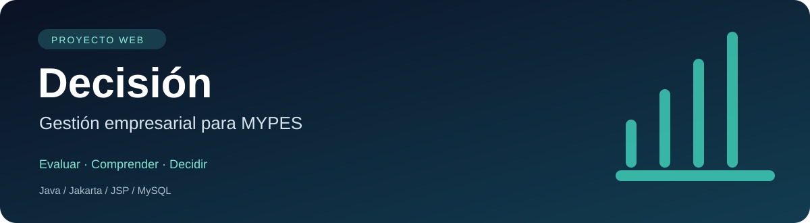
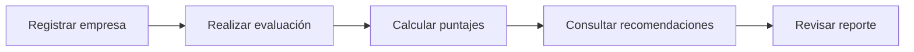
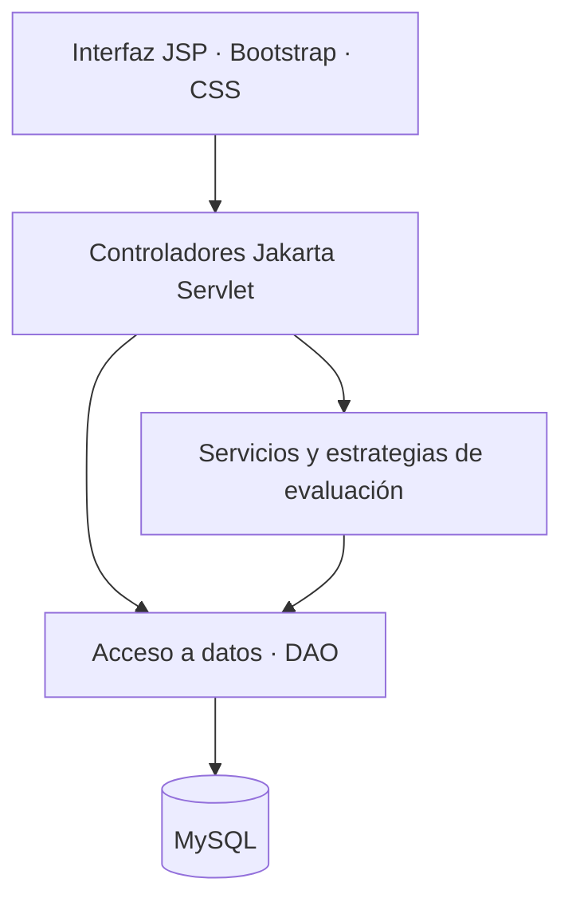

<div align="center">



# Sistema de Decisión Gerencial

**Una herramienta web para evaluar la gestión de las MYPES y orientar sus decisiones.**


[Descripción](#el-proyecto) · [Funciones](#qué-puedes-hacer) · [Carpetas](#organización-del-proyecto) · [Instalación](docs/INSTALACION.md)

</div>

## El proyecto

**Decisión** reúne el registro de empresas, la evaluación de su gestión y la consulta de resultados en un mismo espacio. Está dirigido al trabajo con micro y pequeñas empresas (MYPES), con un recorrido que va desde un cuestionario hasta recomendaciones y reportes para apoyar la revisión de sus áreas de gestión.

El sistema utiliza **30 preguntas distribuidas en seis dimensiones**. Calcula puntajes y genera recomendaciones mediante un motor de reglas predefinidas. La implementación actual no integra un modelo externo de inteligencia artificial; los resultados apoyan la revisión gerencial y no constituyen por sí solos una validación del instrumento.

## Qué puedes hacer

| Módulo | Función |
| :--- | :--- |
| **Resumen general** | Consultar indicadores del sistema y acceder a las secciones principales. |
| **Empresas** | Registrar y consultar información empresarial. |
| **Evaluaciones** | Completar el cuestionario con un indicador de avance. |
| **Análisis empresarial** | Consultar recomendaciones elaboradas mediante reglas. |
| **Resultados** | Revisar puntajes y niveles de evaluación. |
| **Reportes** | Consultar el detalle de los resultados para su revisión. |

### Experiencia de uso

La interfaz incorpora navegación lateral, menú adaptable a móviles, búsqueda en tablas, identificación visual de niveles y pantallas con estilos compartidos. El acceso utiliza sesiones de usuario y contraseñas almacenadas con BCrypt.



## Organización del proyecto

Se mantiene la estructura estándar de Maven para abrir y ejecutar el proyecto en NetBeans.

```text
Proyecto_Sistema_Decision_Gerenciales_IA/
├── src/
│   ├── main/
│   │   ├── java/
│   │   │   ├── controller/          # Servlets y navegación
│   │   │   ├── dao/                 # Consultas y persistencia con JDBC
│   │   │   ├── model/               # Entidades del sistema
│   │   │   ├── service/             # Cálculos y lógica de negocio
│   │   │   ├── strategy/            # Motor de recomendaciones por reglas
│   │   │   ├── util/                # Conexión privada y utilidades
│   │   │   └── com/                 # Configuración Jakarta REST
│   │   ├── resources/              # Recursos de configuración
│   │   └── webapp/
│   │       ├── assets/              # CSS y JavaScript compartidos
│   │       ├── WEB-INF/ui/          # Navegación y pie de página
│   │       └── *.jsp               # Pantallas del sistema
│   └── test/java/
│       ├── strategy/               # Prueba unitaria del motor
│       └── integration/            # Prueba opcional con MySQL
├── config/                         # Plantilla sin credenciales
├── docs/                           # Documentación del proyecto
│   ├── assets/                     # Recursos de presentación
│   └── INSTALACION.md              # Guía de instalación y pruebas
├── BD_Sistema Decision Gerencial.sql
├── Dockerfile                      # Preparación para contenedores
├── DESPLIEGUE.md                    # Guía de alojamiento
├── railway.json                    # Configuración opcional de Railway
├── nb-configuration.xml            # Configuración compartida de NetBeans
├── pom.xml                         # Dependencias y compilación
└── README.md                       # Presentación del proyecto
```

### Explorar por carpeta

| Carpeta | Contenido |
| :--- | :--- |
| [Código Java](src/main/java) | Controladores, modelos, servicios y acceso a datos. |
| [Interfaz web](src/main/webapp) | Pantallas JSP y componentes de navegación. |
| [Estilos y comportamiento](src/main/webapp/assets) | Recursos visuales y JavaScript. |
| [Pruebas](src/test/java) | Verificaciones unitarias y de integración. |
| [Configuración](config) | Ejemplo de conexión sin contraseñas. |
| [Documentación](docs) | Instalación, configuración y pruebas. |

## Arquitectura



| Capa | Responsabilidad |
| :--- | :--- |
| **Presentación** | Formularios, panel, tablas y reportes. |
| **Controladores** | Gestionar solicitudes y seleccionar las vistas. |
| **Servicios y estrategias** | Procesar evaluaciones y recomendaciones. |
| **Persistencia** | Consultar y guardar registros mediante JDBC. |

## Ejecutarlo en tu equipo

Necesitas Java, Maven, un contenedor Tomcat compatible con Jakarta y MySQL. Abre la carpeta que contiene `pom.xml` en NetBeans.

1. Importa el SQL en una **base nueva**.
2. Configura la conexión en un archivo privado fuera del repositorio.
3. Compila y crea el primer administrador.
4. Ejecuta el proyecto desde NetBeans.

**[Consultar la guía completa de instalación](docs/INSTALACION.md)**

La guía incluye los comandos, la configuración de conexión y las condiciones de las pruebas. La prueba de integración requiere una base preparada y está omitida de forma predeterminada.

## Estado y alcance

- Proyecto disponible para consultar y descargar desde GitHub.
- Ejecución local mediante NetBeans, Tomcat y MySQL.
- Archivos de preparación Docker incluidos; no hay una aplicación pública alojada.
- SQL de instalación con estructura y catálogos, sin cuentas ni datos empresariales locales.
- Credenciales privadas y archivos generados de `target/` excluidos del repositorio.

---

<div align="center">

**Decisión · Gestión empresarial para MYPES**  
Repositorio de [Luis Angel Salinas Bardales](https://github.com/luiangelsb26)

</div>
